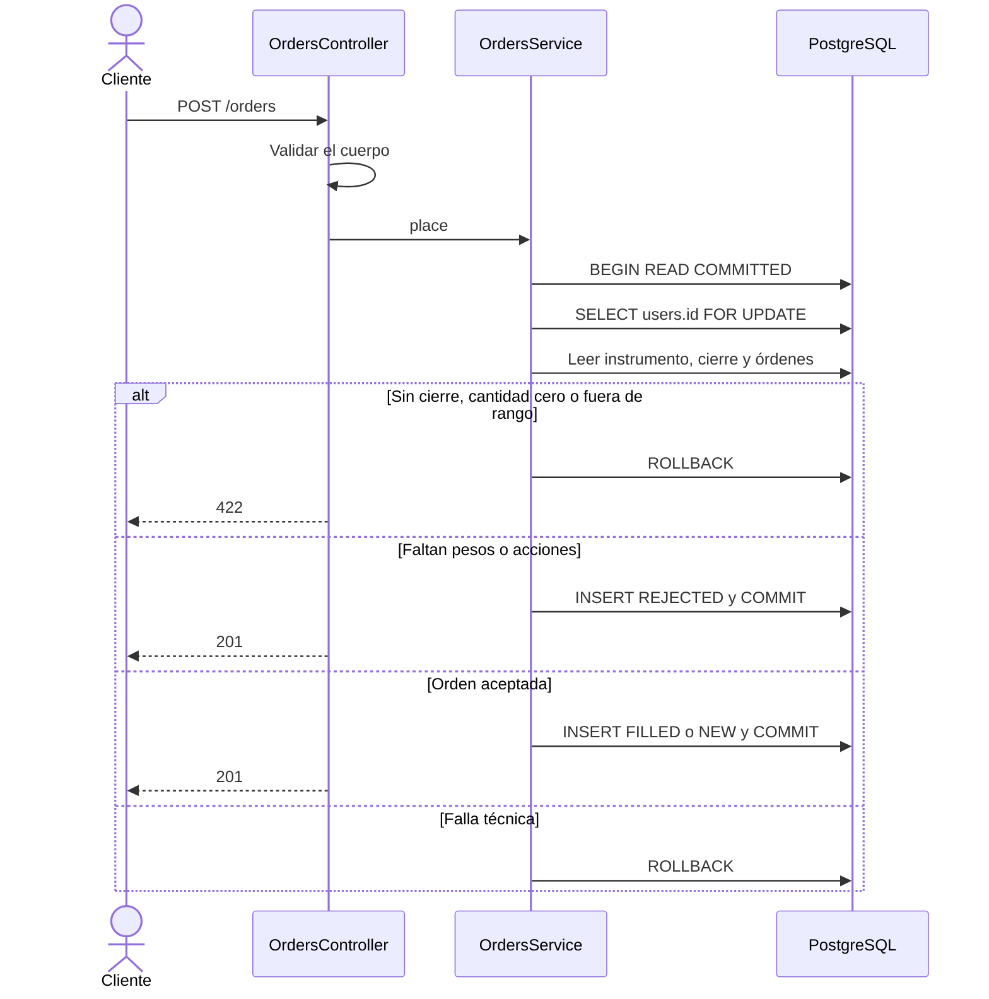

# Notas técnicas

El servicio es un proceso Nest. Los módulos son instrumentos, cartera, órdenes y base de datos. Hay tres rutas: `GET /instruments`, `GET /users/:userId/portfolio` y `POST /orders`.

La base de la API es un PostgreSQL local. `DATABASE_URL` apunta ahí. Neon queda en `NEON_DATABASE_URL` y no se usa para escribir. Para levantar la base: `npm run db:up`. Docker crea el contenedor y carga `database.sql`, que trae el esquema y los datos de prueba. `npm run test:db` comprueba la conexión: hay 4 usuarios y filas en instrumentos, órdenes y cotizaciones. `npm run db:reset` borra el volumen y vuelve a cargar el archivo. El ejemplo de la URL local está en `.env.example`.

`GET /users/:userId/portfolio` devuelve `totalValue`, `availableCash` y `positions`. Los importes salen como texto con dos decimales, por ejemplo `"500.00"`. `totalReturnPct` es un número con dos decimales, o `null` cuando la tenencia es negativa o falta el costo o el cierre.

El efectivo suma los ingresos, los egresos y las operaciones `FILLED`. Una compra `LIMIT` en `NEW` reserva el importe: baja `availableCash` y no toca el total ni suma acciones. `CANCELLED` y `REJECTED` no mueven nada, aunque el precio sea nulo. Si una fila que sí cuenta no trae el tamaño, el precio o el instrumento que hace falta para aplicarla, la cartera y el alta de órdenes responden 500 con `INTERNAL_ERROR` y el `requestId`. El detalle queda en el log, sin datos personales. En las órdenes, la transacción se revierte y no queda una fila nueva. Una tenencia en cero no aparece. Si el último cierre con fecha falta, es cero, negativo o no es un número finito, `marketValue` y `totalReturnPct` quedan `null` y el total de la cuenta también. El efectivo se sigue informando. Un cierre anterior no reemplaza a ese.

El costo promedio se actualiza con las compras ejecutadas. Una venta parcial lo deja igual. Si la tenencia vuelve a cero, el costo se olvida. Una compra que pasa de −10 a 5 acciones usa el precio de esa compra para las 5 que quedan abiertas. Con un cierre de 120 y un costo de 100, el rendimiento es 20.

Un id que no es un entero positivo responde 400. Un usuario que no existe responde 404 con `USER_NOT_FOUND`. Un usuario sin movimientos responde `"0.00"`, `"0.00"` y `positions` vacío. El cierre que se usa es la última fila de `marketdata` que tiene fecha. Si la fecha coincide, gana el id mayor. Una fila sin fecha no entra.

`GET /instruments?query=` busca el texto en el ticker o en el nombre, sin distinguir mayúsculas. "ggal" devuelve GGAL. "Galicia" también, porque está en el nombre. Si el ticker coincide entero, esa fila va primero. El resto se ordena por ticker y después por id. Si no hay coincidencias, la respuesta es `[]`. `%` y `_` se buscan como caracteres, no como comodines. Si `query` no viene, o queda vacío al quitar espacios, la respuesta es 400 con código `VALIDATION_ERROR` y el campo `query` en `details`.

Cada solicitud recibe un id. Sale en el header `X-Request-Id`. Si la respuesta es un error, el mismo id va en el cuerpo. Al terminar se escribe una línea JSON con el método, la ruta, el estado HTTP y la duración.

Un dato inválido responde 400, con código `VALIDATION_ERROR`. `details` nombra el campo. Para el texto "amount must be a positive number", el campo es `amount` y el mensaje es el resto.

Un fallo que no estaba previsto responde 500. El mensaje público es "Error interno" y lleva el `requestId`. La causa y el stack se escriben una sola vez, en un log de nivel error. No vuelven en el JSON.

`POST /orders` crea una orden nueva cada vez. Si el cliente no recibe la respuesta y vuelve a enviarla, puede aparecer otra fila mientras todavía haya disponibilidad. La transacción arranca en `READ COMMITTED`, bloquea `users.id` con `SELECT ... FOR UPDATE` y recién después lee el efectivo y las acciones libres. Una `MARKET` válida queda `FILLED` al último cierre. Una `LIMIT` válida queda `NEW`. Si faltan pesos o acciones, la fila se guarda igual, en `REJECTED`, con `INSUFFICIENT_FUNDS` o `INSUFFICIENT_SHARES`. Un monto que no alcanza para una acción responde 422 con `ZERO_ORDER_QUANTITY` y no inserta. Un precio `LIMIT` mayor a `99999999.99` responde 400 sobre el campo `price`. Si el monto calcula más de `2147483647` acciones, responde 422 con `ORDER_QUANTITY_OUT_OF_RANGE` y no inserta. Una `MARKET` sin cierre utilizable responde 422 con `QUOTE_UNAVAILABLE` y tampoco inserta. Cero, negativo o no finito cuentan como cierre inutilizable, aunque haya uno anterior positivo. Una `LIMIT` usa el precio enviado. Una compra por $950 a $100 toma 9 acciones y deja el resto afuera. Si el monto pedido supera el efectivo, se rechaza aunque el importe redondeado entre.

Los errores conocidos usan `AppError`, con estado, código y mensaje. La cartera lanza `USER_NOT_FOUND`. Las órdenes lanzan ese código, `INSTRUMENT_NOT_FOUND`, `ZERO_ORDER_QUANTITY`, `QUOTE_UNAVAILABLE` y `ORDER_QUANTITY_OUT_OF_RANGE`.

El envío de una orden sigue este orden:
 -El controller valida el cuerpo antes de tocar la base. 
 -El service abre la transacción, bloquea al usuario y solo después lee el cierre y las órdenes previas. 
 -Si el monto no compra una acción, la cantidad no entra en la columna, o la orden es `MARKET` y no hay cierre, hace rollback y responde 422. 
 -Si faltan pesos o acciones, inserta `REJECTED` y confirma. 
 -Si alcanza, inserta `FILLED` o `NEW` y confirma. Una excepción a mitad de camino también hace rollback.

La corrida de entrega usa Node 22.18.0, NestJS 12.5.0, Vitest 4.1.12, oxlint 1.93.0 y PostgreSQL 16.16. `npm test` corre los unitarios. `npm run test:integration` llama al servicio y al repositorio contra PostgreSQL, sin HTTP. `npm run test:e2e` entra por la API. `npm run test:all` junta los tres. Los otros comandos de la corrida son `npm run db:up`, `npm run lint` y `npm run build`. El 14 de noviembre de 2026 el lint cerró sin errores, el build compiló y `test:all` dejó 78 tests en verde. Entran la búsqueda, la cartera del usuario 1, el 422 sin insert, el rollback y las dos compras de $800 que esperan el mismo `users.id`: una `FILLED`, una `REJECTED` y $200 disponibles.

Los hooks se activan al clonar con `npm install`. El script `prepare` copia `.githooks` a `.git/hooks`. Después de cada commit corren los tests, y el commit queda aunque fallen. Antes de un push corren lint, tests y build, en ese orden. Si uno falla, el script sale con código distinto de cero y el push no sigue.
